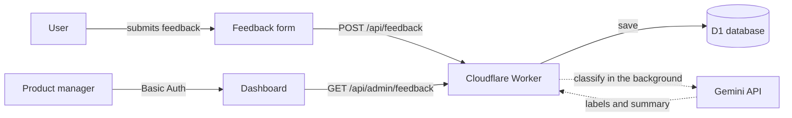

# 💬 Feedback Hub

A small, production-ready product that collects user feedback and sorts it automatically with AI — so a product manager can spend time on decisions instead of triage.

**Live:** [feedback-hub.aydin-omer.workers.dev](https://feedback-hub.aydin-omer.workers.dev) (the dashboard is password-protected)

This project was built end to end the way a real product team works: starting from a PRD, breaking it into user stories, and shipping each one through tests, pull requests, and an automated deployment pipeline. The [PRD](docs/PRD.md) and its decision log are part of the repository.

## The problem

A product manager receives feedback from many places and reads it all by hand. That takes hours every week, so it gets postponed — and questions like *"what is the most common complaint this month?"* are answered by gut feeling instead of data.

## What it does

- **Public feedback form** — anyone can leave a message, with an optional email for a reply
- **Automatic AI classification** — every submission is labeled with a type (bug, feature request, UX issue, praise, other), sentiment, urgency, and a one-sentence summary
- **Dashboard for the PM** — newest feedback first, filters by type, sentiment, and urgency, and counts per category
- **Spam protection** — each visitor can submit at most 5 times per hour
- **Protected admin area** — only the PM can see the dashboard and the data behind it

## Architecture



- **Frontend:** static HTML pages (form and dashboard), served by the same Worker
- **Backend:** a serverless API on [Cloudflare Workers](https://developers.cloudflare.com/workers/), written in TypeScript
- **Database:** [Cloudflare D1](https://developers.cloudflare.com/d1/) (SQLite), with versioned migrations
- **AI:** [Google Gemini API](https://ai.google.dev/), called only from the backend
- **Cost:** runs entirely on free tiers

## Engineering practices

- **Test-driven development** — every acceptance criterion in the PRD became an automated test before the code was written. External services are mocked, so tests are fast and reliable.
- **CI/CD** — every pull request runs the test suite; every merge to `main` applies database migrations and deploys to production automatically, but only if the tests pass.
- **Database migrations** — schema changes are versioned files applied the same way locally, in tests, and in production.
- **Reliability by design** — feedback is saved before AI classification runs in the background, so a slow or failing AI service never blocks or loses a submission.
- **Documented decisions** — trade-offs are recorded in the PRD's decision log, so it's clear what was a deliberate choice and what would be a bug.

## Security and privacy

- **Secrets** live only in Cloudflare's encrypted secret store and in a git-ignored local file, never in the code
- **SQL injection** is prevented with bound parameters and allow-listed filter values
- **Stored XSS** is prevented by rendering all user data as text, never as HTML
- **Prompt injection** is limited by marking user input as data and validating every AI answer against an allow-list of labels
- **IP addresses are never stored** — rate limiting uses a salted hash instead
- **Admin access** uses constant-time password comparison and fails closed if the secret is missing
- **Data minimization** — the admin API returns only the fields the dashboard needs

## Project structure

```
docs/PRD.md                  → Product requirements and decision log
app/src/index.ts             → Request routing and feedback submission
app/src/classify.ts          → Gemini integration and output validation
app/src/rate-limit.ts        → Per-visitor rate limiting
app/src/auth.ts              → Admin authentication
app/src/admin.ts             → Admin API: listing, filters, counts
app/public/                  → Feedback form and dashboard
app/migrations/              → Versioned database schema changes
app/test/                    → Automated tests
.github/workflows/ci.yml     → Test and deployment pipeline
```

## Running it locally

Requirements: Node.js (LTS) and a free Cloudflare account.

```bash
cd app
npm install
```

Create `app/.dev.vars` with your own values (this file is git-ignored):

```
GEMINI_API_KEY=your-gemini-api-key
IP_HASH_SALT=a-long-random-value
ADMIN_PASSWORD=a-long-random-password
```

Set up the local database and start the app:

```bash
npx wrangler d1 migrations apply feedback-hub-db --local
npm run dev
```

The form runs at `http://localhost:8787` and the dashboard at `http://localhost:8787/admin` (username `admin`).

Run the tests:

```bash
npm test
```

## Status

All six MVP user stories are done. Possible next steps are listed in the PRD's out-of-scope section, such as grouping similar feedback into themes and correcting AI labels from the dashboard.

## Related

- [feedback-hub-mcp](https://github.com/aydin-omer/feedback-hub-mcp): an MCP server that lets AI assistants like Claude read and analyze Feedback Hub data.
